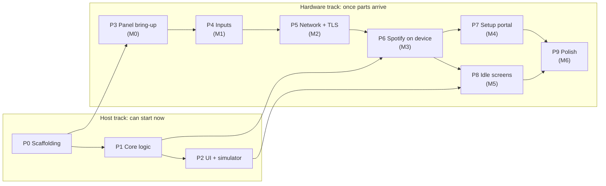

# On-Air — Software Implementation Plan

**Status:** Draft v0.1 · **Date:** 2026-11-08 · **Updated:** 2026-11-16 · **Owner:** Mathew Wheatley

How the firmware gets built, in what order, and how each piece is tested. Requirement IDs (D-1, S-3, …) refer to [requirements.md](requirements.md).

## 1. Approach

- **Host first.** Most of the logic (Spotify parsing, OAuth, polling schedule, state machine, screens, input handling) doesn't need hardware. It goes in `no_std` crates that build and test on the Mac. Work can start before the MatrixPortal arrives.
- **One rendering path.** Every screen is drawn through `embedded-graphics`, so the same code runs in a desktop simulator and on the panel.
- **Thin firmware.** The `firmware/` crate only wires hardware, network and tasks to the shared crates. If it holds logic that could be tested on the host, move it out.
- **Use existing crates.** Reach for a maintained crate before writing anything. Only write logic that's specific to On-Air. §2.4 lists the choices.
- **Spike the risky parts early.** Panel driver (R-1), TLS (R-2) and AP+STA WiFi (P-4) each get a small proof before features are built on them.



## 2. Code layout

The repo is a Cargo workspace for the host-buildable crates. Folders are short (`crates/core`, `crates/ui`), and the package names carry the prefix (`on-air-core`, `on-air-ui`). A bare `core` package name would clash with Rust's built-in `core` library. `firmware/` sits outside the workspace because it needs the Xtensa toolchain and its own target. It depends on the shared crates by path.

```
on-air/
├── Cargo.toml               workspace: crates/*, tools/sim
├── crates/
│   ├── core/                crate `on-air-core`: no_std + alloc: models, parsing, state machine, scheduling
│   └── ui/                  crate `on-air-ui`: no_std, every screen, drawn on any embedded-graphics DrawTarget
├── tools/
│   └── sim/                 desktop simulator (embedded-graphics-simulator, SDL2)
└── firmware/                ESP32-S3 binary (esp-hal + Embassy), not a workspace member
    ├── .cargo/config.toml
    ├── rust-toolchain.toml  channel = "esp"
    ├── partitions.csv       adds a `settings` data partition
    └── src/
```

### 2.1 `on-air-core` modules

| Module | What it holds | Requirements |
|---|---|---|
| `auth` | PKCE verifier and challenge (SHA-256 + base64url), authorize-URL builder, callback-URL parser that pulls out `code`, token-response parsing. | S-1, S-7, P-4 |
| `spotify` | `currently-playing` response model for tracks and podcast episodes. Picks the 300 px image (D-3). Maps status codes to outcomes: 200, 204, 401, 403 (no Premium), 429 with `Retry-After`. | S-3–S-6 |
| `http` | Plain request and reply types, so core logic can ask for HTTP without doing it. Each host sends them with its own client. | — |
| `spotify_sync` | The Spotify loop without the network: says which request to send next (token refresh, poll, playback command, cover download), reads each reply and reports what changed. Handles 401, 429, outages, rotated refresh tokens and quick polls after a button. | S-1–S-6 |
| `schedule` | Pure functions that return the next poll delay: 5 s playing, 30 s idle, an extra poll at track end from `progress_ms` / `duration_ms`, and `Retry-After`. | S-3, S-4, N-1 |
| `backoff` | One exponential-backoff type with jitter, shared by WiFi (max 60 s), Spotify and weather (max 15 min). | N-3, W-5 |
| `weather` | Open-Meteo forecast and geocoding models, WMO code to icon mapping, and the 2 h staleness check. | W-1, W-3, W-4, D-12 |
| `tide` | Open-Meteo marine heights to high and low tide times, and the city's tide check. | W-6, W-7 |
| `weather_sync` | The weather and tides loop without the network, like `spotify_sync`: fetches the forecast every 15 min and tides every 6 h, only for the selected idle screen, retries an unknown tide check, and backs off on errors. | W-2, W-5–W-7 |
| `wifi` | The WiFi state machine without the radio: Connecting, Online, Lost and Portal. Falls back to the setup hotspot when the saved network can't be joined within 30 s at boot, and retries a dropped connection with backoff. | P-1, N-3, §6.2 |
| `frame` | Turns each drawn frame into what the panel shows: cover crossfade, gamma, current cap and brightness in one step. | D-4, D-8 |
| `supervisor` | Task check-ins, and whether to feed the hardware watchdog. | N-4 |
| `app` | The main state machine. Takes events (playback update, button, tick, weather, network status) and returns the screen to show. Covers playing, paused, idle and status, the idle timer (owner setting, default 5 min), the idle-screen cycle and the mode-tap preview. | D-5–D-7, D-6 diagram |
| `input` | Button debounce (`debouncr`), tap and hold detection (Mode 5 s, Mode + Play 10 s). Knob smoothing, hysteresis, perceptual curve and the 5% floor. | §3.5, P-6 |
| `image` | JPEG decode wrapper (`zune-jpeg`), downscale fallback, gamma table, crossfade blend, current estimate and brightness cap. | D-2–D-4, D-8 |
| `portal` | The setup page and `Portal`, which handles every portal request without I/O, asking the host to fetch only for city search and the token exchange. | P-1–P-7 |
| `settings` | Settings struct with a schema version, serialized with `postcard`. Handles defaults and migrations. | §6.3 |
| `timezone` | Thin wrapper over `jiff` with its bundled IANA database (about 230 KB of flash). Converts UTC to local time for zones named like `America/Los_Angeles`. | D-9 |

### 2.2 `on-air-ui` screens

Each screen is a function `draw(&ScreenModel, &mut impl DrawTarget<Color = Rgb888>)`.

- Album art (from a decoded framebuffer), with paused dimming
- Digital clock, analog clock, weather, clock + weather, weather + tides, last song, off
- Status screens: setup QR + network name, Connecting…, Spotify sign-in needed, No WiFi, Premium needed
- Overlays: button feedback icons (500 ms), "stale" weather marker
- Small icon set (weather conditions, play/pause/next/previous, WiFi), drawn as image files and loaded with `tinyqoi` or `tinybmp`. Clock digits come from `u8g2-fonts`, which has many pixel fonts.

### 2.3 Firmware modules

| Module | Job |
|---|---|
| `main.rs` | Init clocks, PSRAM heap (`esp-alloc`), Embassy, then spawn tasks. |
| `board.rs` | Pin map for the MatrixPortal S3: HUB75 pins, A0–A4 to GPIO numbers. One place to change. |
| `display_task` | Owns `esp-hub75` and two framebuffers. Runs the `app` state machine from core, renders with `on-air-ui`, then passes each frame through `core::frame::FramePipeline` for the crossfade, gamma, brightness and current cap. |
| `input_task` | Samples the knob at 20 Hz and polls buttons. Feeds `core::input` and sends events. |
| `net/wifi` | Runs `core::wifi::WifiLink` on `esp-radio` + `embassy-net`: joins or starts the hotspot when it asks, and reports joins and drops. |
| `net/http` | One HTTPS client wrapper (`reqwless` + chosen TLS) with pinned root CAs and streamed reads. |
| `net/sntp` | Time sync at boot and every few hours. |
| `spotify_task` | Runs `core::spotify_sync::SpotifySync`: sends each request it asks for with `reqwless`, waits on the command channel between polls, and saves rotated refresh tokens to `storage`. |
| `weather_task` | Runs `core::weather_sync::WeatherSync`: sends each request it asks for, passes it the selected idle screen, and saves the city's tide check answer. |
| `portal/` | Soft AP, captive-portal DNS (`edge-captive`), and a `picoserve` server that passes each request to `core::portal::Portal` and acts on its events (join WiFi, save, restart). |
| `storage` | `sequential-storage` on the `settings` partition. Writes only when a value changes, to limit flash wear. |
| `supervisor` | Every task checks in with `core::supervisor::Supervisor`. The watchdog is fed only while every task has checked in recently, so one stuck task still triggers a reset. |

**Task communication:**
- `Channel<Command>` for playback commands (input to Spotify).
- `Watch<NowPlaying>`, `Watch<WeatherReading>` and `Watch<NetStatus>` for the latest state.
- `Signal<Brightness>` for the knob.
- The display task subscribes to all of them and is the only task that touches the panel.

**Memory:**
- HUB75 DMA buffers stay in internal SRAM, since DMA from PSRAM risks flicker.
- The heap is in PSRAM and holds TLS buffers, JSON and JPEG decoding (R-5).
- Spotify calls pass `market=from_token`, which drops the long `available_markets` lists and keeps responses small.

### 2.4 Crates

Every crate must build without the standard library (except in `tools/sim`), and on Rust 1.90 (see the P0 notes).

| Concern | Crate | Used in |
|---|---|---|
| JSON | `serde` + `serde_json` (with `alloc`) | core |
| Settings format | `postcard` | core |
| PKCE | `sha2` + `base64` | core |
| Query strings, form bodies | `form_urlencoded` | core |
| Timezones and local time | `jiff` with its bundled IANA database | core |
| JPEG decoding | `zune-jpeg` | core |
| Button debounce | `debouncr` | core |
| Drawing | `embedded-graphics` | ui |
| Clock and text fonts | `u8g2-fonts` | ui |
| Icons, from image files | `tinyqoi` or `tinybmp` | ui |
| QR code | `qrcodegen-no-heap` | ui |
| Desktop window | `embedded-graphics-simulator` (SDL2) | sim |
| Host HTTP, for `--live` | `reqwest` | sim |
| HAL, runtime, WiFi | `esp-hal`, `esp-rtos` (Embassy), `esp-radio`, `embassy-net` | firmware |
| Panel driver | `esp-hub75` | firmware |
| HTTPS client | `reqwless` + TLS (`esp-mbedtls` or `embedded-tls`) | firmware |
| SNTP | `sntpc` | firmware |
| Captive-portal DNS | `edge-captive` | firmware |
| Portal web server | `picoserve` | firmware |
| Settings storage | `sequential-storage` | firmware |

Still hand-written, because they're short and specific to On-Air:
- the backoff
- the poll schedule
- the button taps and holds
- the knob curve
- the 64 px box-filter resize
- the current cap

## 3. Phases

Each phase lists its tasks and when it counts as done. Ticked tasks are finished; a ✅ on the heading means the whole phase is.

| Phase | Status |
|---|---|
| P0 Scaffolding | ✅ Done |
| P1 Core logic | ✅ Done |
| P2 UI + simulator | ✅ Done |
| P3 Panel bring-up | ✅ Panel works. The current and temperature measurements are still to do. |
| P4 Inputs | Waiting on the buttons and knob. UP and DOWN stand in for the knob. |
| P5 Network + TLS | In progress. WiFi joins and PSRAM works; SNTP, TLS and AP+STA to do. |
| P6 Spotify on device | Not started. The logic is done in core. |
| P7 Setup portal | Host side done. The device side is not started. |
| P8 Idle screens | Not started. The screens and weather logic are done on the host. |
| P9 Polish | Host side done. The device side is not started. |

### P0 — Scaffolding (host) ✅

- [x] Install the toolchain: `espup install`, `cargo install espflash esp-generate`.
- [x] Create the workspace, `on-air-core`, `on-air-ui` and `tools/sim`.
- [x] Generate `firmware/` with `esp-generate` (target ESP32-S3, Embassy, PSRAM, `esp-radio`), then trim it.
- [x] Add `rustfmt`, `clippy` (deny warnings) and a `justfile` with `test`, `sim`, `build`, `flash` and `monitor`.

**Done when:** `just test` passes on the host and `just build` produces a firmware image.

**Notes from doing P0 (2026-11-08):**
- **Intel Mac toolchain limit.** Espressif stopped publishing Xtensa Rust for Intel Macs after **1.90**, so this machine is pinned to it (`espup install --toolchain-version 1.90.0.0`). The shared crates set `rust-version = "1.88"`. Every dependency they or the firmware use must build on Rust 1.90, so check a crate's minimum Rust version before adding it. Moving to an Apple Silicon Mac or Linux later lifts this limit.
- **`esp-rtos`.** The template uses `esp-rtos` (with its `embassy` feature) as the scheduler and the `#[esp_rtos::main]` entry point, not `embassy-executor` directly. `esp-radio` needs it.
- **SDL2 on macOS.** `tools/sim/build.rs` adds Homebrew's lib folder to the linker search path, since recent macOS toolchains don't search it by default.
- **PSRAM.** The template heap is about 72 KB of internal RAM. Moving the heap to PSRAM is left to P5, when TLS needs it. (Done in P5: the board has 2 MB.)

### P1 — Core logic (host) ✅

- [x] Build every module in §2.1 test-first.
- [x] Record real API responses as test fixtures in `crates/core/tests/fixtures/`, with personal data scrubbed:
  - [x] Spotify: track playing, episode playing, paused, 204, 401, 429
  - [x] Open-Meteo: forecast and geocoding
- [x] Test the `app` state machine against the D-6 diagram, one test per arrow.

**Done when:** all modules have unit tests and the fixtures parse.

### P2 — UI + simulator (host) ✅

- [x] Build every screen in §2.2.
- [x] `tools/sim` shows a 64×64 window, scaled up, using the real `app` state machine:
  - [x] Keys 1–4 are the buttons; holding a key counts as a long press.
  - [x] `-` and `+` turn the knob.
- [x] Fake mode plays scripted playback and weather. It's the default, so there's no `--fake` flag.
- [x] `--live` mode runs the real PKCE flow on the Mac (a local listener on `127.0.0.1:8888` catches the callback). It then polls Spotify and Open-Meteo with `reqwest`. This proves the OAuth flow and parsing against the real APIs before any hardware.
- [x] Snapshot tests: render each screen to an in-memory buffer and compare it to a checked-in PNG.

**Done when:** in the simulator, album art follows what's playing on Spotify, the idle screens look readable at 64×64 (R-6), and the snapshots are checked in.

**Notes from doing P2 (2026-11-09):**
- **Sign-in in `--live`.** Spotify redirects to `127.0.0.1:8888`, which on the Mac is the Mac itself, so a small local server (`tiny_http`) catches the callback. The device still uses paste-back. Both share `core::auth`.
- **Icons** are 24-bit BMPs in `crates/ui/assets/icons/`, stored top-down. Black is transparent. Edit them in any pixel editor.
- **Fonts:** `logisoso20`/`logisoso16` digits for the clock and temperature, `5x7` and `4x6` for labels.
- **Setup QR** encodes `WIFI:S:<network>;;` (open network, version 2, 2 px per module) with the name centered below.
- **Snapshots** live in `crates/ui/tests/snapshots/`. `just snapshots` re-renders them, and every test run writes 8× previews to `target/snapshot-previews/`.

### P3 — Panel bring-up (M0)

- [x] Fill in `board.rs` from Adafruit's pinout.
- [x] Set the address-E jumper.
- [x] Drive the panel with `esp-hub75`: solid colors, then a gradient and a pixel-addressing test.
- [x] Check for flicker at 100 Hz or more, and the 6+ bit color depth (D-1, D-2). Measured 152 Hz at 6 bits, with no visible flicker.
- [ ] **To do:** bench-measure the current at full white (Q-3) and the board's temperature at 2.5 A (Q-1). Waiting on a new meter fuse or a USB-C power meter. Measure white at a brightness below the cap (log shows the same level before and after it), subtract the board's own draw, and scale to 255. Until then the cap uses the 4000 mA estimate.

**Done when:** a test pattern shows cleanly and the current numbers are recorded in requirements.md.

**Notes from starting P3 (2026-11-16):**
- **Versions.** `esp-hub75` 0.16 and later need Rust 1.95, past this Mac's 1.90 limit, so the firmware uses 0.15. That needs `esp-hal` 1.1, so the esp crates moved up together to their 2026-04 releases (`esp-radio` 0.18, `esp-rtos` 0.3, `embassy-executor` 0.10 and friends), the last ones on Rust 1.88.
- **Color depth and refresh.** A bitplane framebuffer at 6 bits per channel, clocked at 20 MHz. Each extra bit halves the refresh rate, so 8 bits would flicker. The firmware logs the measured rate every 5 s.
- **Heap.** WiFi takes most of the template's 72 KB heap, so a second 96 KB region comes out of the otherwise-unused stack space, for the display's frame buffers.
- **Test patterns** go through `FramePipeline::for_panel`, so gamma and the current cap apply and full white can't overdraw the supply. They cycle every 3 s: solid red, green, blue and white, then `on_air_ui::draw_test_pattern` (bars and a grey ramp) and `draw_addressing_pattern` (a colored block in each corner, to catch flipped or repeated halves).

**If it fails (R-1):** try the FM6126A init sequence. If that fails too, wrap the C `ESP32-HUB75-MatrixPanel-DMA` library through `esp-idf`.

### P4 — Inputs (M1)

- [ ] `input_task` on real pins, using `core::input`.
- [ ] Knob drives brightness on the test pattern, with the floor and curve.
- [ ] Buttons log tap and long-press events.

**Done when:** the knob dims smoothly with no jitter, and all four buttons and both long presses are detected.

**Until the buttons and knob arrive (2026-11-16):** the board's own UP (GPIO6) and DOWN (GPIO7) buttons stand in for the knob. `core::input::KnobButtons` turns each press into one step of a pretend knob, repeating while held, and feeds it through `Knob`, so the curve and floor match. The firmware's `knob_buttons_task` sends the result on the brightness signal, and `main` logs it until the panel is driven. The four playback buttons wait for the parts.

### P5 — Network + TLS spike (M2)

- [x] Join WiFi from hard-coded credentials (in a git-ignored `.env`, read at build time). `wifi_task` runs `core::wifi::WifiLink`, with `ON_AIR_WIFI_SSID` and `ON_AIR_WIFI_PASSWORD` from `.env`, and gets an address over DHCP.
- [x] Move the heap to PSRAM. The board has 2 MB (quad SPI), added to the heap at boot.
- [ ] SNTP time.
- [ ] **TLS decision (R-2):** try `esp-mbedtls` first, since it has fuller certificate checks and supports TLS 1.2. Fall back to `embedded-tls` only if memory is too tight. Check all five hosts in R-2 with certificate verification on.
- [ ] **AP+STA spike (P-4):** keep a soft AP up while joined to home WiFi.

**Notes so far (2026-11-16):**
- **Memory at boot**, with WiFi up and the test patterns running: the 72 KB internal region is 96% used (2.5 KB free), the extra 96 KB region has 72 KB free, and PSRAM's 2 MB is untouched. The allocator fills internal RAM first, so TLS buffers, JSON and covers should go to PSRAM explicitly (an allocator with `MemoryCapability::External`), keeping internal RAM for WiFi and DMA.
- **Current cap seen working:** full white at brightness 150 is capped to 137, matching the 2150 mA budget under the 4000 mA full-white estimate.

**Done when:**
- An HTTPS GET to each host succeeds with certificates verified.
- Heap use stays within budget.
- AP+STA works.
- The result is recorded in requirements.md (R-2).

### P6 — Spotify on device (M3)

- [ ] `spotify_task` with a hard-coded refresh token:
  - [ ] token refresh
  - [ ] polling on `core::schedule`
  - [ ] art download, decode and display
- [ ] Playback buttons, with a "Premium needed" icon on 403.
- [ ] Save rotated refresh tokens to `storage`.

**Done when:** the panel follows real playback within the N-1 latency targets, and the buttons control Spotify.

### P7 — Setup portal (M4)

- [ ] Soft AP `OnAir-XXXX`, captive-portal DNS with `edge-captive`, and captive-portal detection URLs that redirect to the form (`/generate_204`, `/hotspot-detect.html`).
- [ ] Serve `core::portal::PAGE` and the routes listed in `core::portal` with `picoserve`. The page, form checking, sign-in session and JSON replies are already built and tested; the device supplies the WiFi scan, joining, geocoding and the token exchange.
- [ ] Paste-back sign-in using `core::portal::SignIn`, then the token exchange over AP+STA.
- [ ] Settings saved, then a reboot. Long-press handling for portal reopen and factory reset (P-6).
- [ ] **Q-4:** test on an iPhone and an Android phone. Decide between mobile-data fallback, bridging, or a "open in full browser" instruction.

**Done when:** a factory-reset device goes from first boot to showing art using only a phone.

**Done early, on the host (2026-11-09):** the portal page (`crates/core/assets/portal.html`, about 14 KB) and `core::portal` (form checking, sign-in session, status and JSON replies, captive-portal probe paths), with tests. The simulator serves it at `http://127.0.0.1:8080` (`just sim --portal`), with pretend WiFi and real city search and Spotify sign-in.

### P8 — Idle screens on device (M5)

- [ ] Hook the `on-air-ui` idle screens to SNTP time and `weather_task`.
- [ ] Fetch tide times in `weather_task` while the Weather + tides screen is selected (`core::tide`), and redo the city's tide check while it's still unknown, saving the answer.
- [ ] Save the selected idle screen.
- [ ] Mode-tap preview while music is playing.

**Done when:** all the idle screens work on the panel, weather and tides refresh on schedule, a city's tide check is saved, and nothing is fetched when no weather screen is selected.

### P9 — Polish (M6)

- [ ] Crossfade between covers (D-4).
- [ ] Backoff everywhere (N-3).
- [ ] Supervisor and watchdog (N-4).
- [ ] Tune the current cap against the P3 measurements.
- [ ] Boot-time check (N-2).
- [ ] **Soak test:** run for 48 h, unplugging the router a few times and blocking Spotify.

**Done when:** it survives the soak test with no manual reboot, and every requirement in requirements.md is checked off.

**Done early, on the host (2026-11-09):** the logic behind the crossfade, backoff and watchdog lives in core and is tested: `frame` (crossfade, gamma, current cap), `wifi` (connect, reconnect and hotspot fallback), `weather_sync` (weather and tides loop) and `supervisor` (watchdog decisions). The simulator runs `frame`, `wifi` (with a pretend router on the W key) and `weather_sync`. The firmware still has to wire them to the hardware.

## 4. Testing

| Level | What | Where |
|---|---|---|
| Unit | Every `on-air-core` module, plus API fixtures | `cargo test` on the host |
| Snapshot | Every screen in `on-air-ui`, compared to PNGs | `cargo test` on the host |
| Live | OAuth + polling against the real Spotify and Open-Meteo APIs | `tools/sim --live` |
| Device | Per-phase checklist (each phase's "done when"), run by hand with serial logs | MatrixPortal |
| Soak | 48 h with network faults | MatrixPortal, P9 |

## 5. Decisions to make

| # | Decision | When | Leaning |
|---|---|---|---|
| 1 | TLS library (R-2) | P5 | `esp-mbedtls` |
| 2 | JSON parsing: `serde_json` + `alloc` or `serde-json-core` | Done | Decided: `serde_json` + `alloc`. The heap is in PSRAM anyway and it's simpler. |
| 3 | Timezone entry in the portal | Done | Decided: the timezone comes from the city picked in the portal. Open-Meteo geocoding returns an IANA name, which `jiff`'s bundled database uses directly. |
| 4 | Logging: `log` + `esp-println` or `defmt` | Done | Decided: `log`, since it's easier. Switch to `defmt` only if log size or speed becomes a problem. |
| 5 | Q-4 fix for phone internet during sign-in | P7 | Decide after testing on real phones. |

## 6. After v1

Stretch goals, such as a larger 128×128 panel and live visualizations driven by a microphone, are listed in [requirements.md §11](requirements.md#11-stretch-goals-after-v1). They get their own plan once v1 is done.
