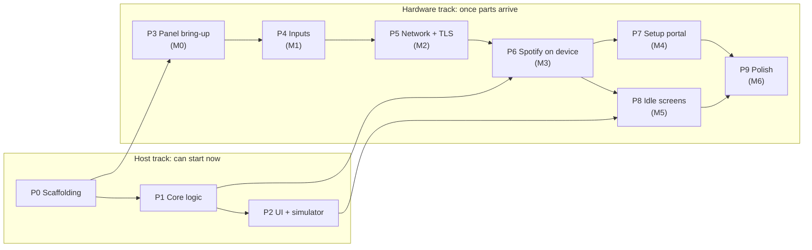

# On Air — Software Implementation Plan

**Status:** Draft v0.1 · **Date:** 2026-11-08 · **Owner:** Mathew Wheatley

How the firmware gets built, in what order, and how each piece is tested. Requirement IDs (D-1, S-3, …) refer to [requirements.md](requirements.md).

## 1. Approach

- **Host first.** Most of the logic (Spotify parsing, OAuth, polling schedule, state machine, screens, input handling) doesn't need hardware. It goes in `no_std` crates that build and test on the Mac. Work can start before the MatrixPortal arrives.
- **One rendering path.** Every screen is drawn through `embedded-graphics`, so the same code runs in a desktop simulator and on the panel.
- **Thin firmware.** The `firmware/` crate only wires hardware, network and tasks to the shared crates. If it holds logic that could be tested on the host, move it out.
- **Spike the risky parts early.** Panel driver (R-1), TLS (R-2) and AP+STA WiFi (P-4) each get a small proof before features are built on them.



## 2. Code layout

The repo is a Cargo workspace for the host-buildable crates. Folders are short (`crates/core`, `crates/ui`), and the package names carry the prefix (`on-air-core`, `on-air-ui`). A bare `core` package name would clash with Rust's built-in `core` library. `firmware/` sits outside the workspace because it needs the Xtensa toolchain and its own target. It depends on the shared crates by path.

```
on-air/
├── Cargo.toml               workspace: crates/*, tools/sim
├── crates/
│   ├── core/                crate `on-air-core`: no_std + alloc: models, parsing, state machine, scheduling
│   └── ui/                  crate `on-air-ui`: no_std, every screen, drawn on any embedded-graphics DrawTarget
├── tools/
│   └── sim/                 desktop simulator (embedded-graphics-simulator, SDL2)
└── firmware/                ESP32-S3 binary (esp-hal + Embassy), not a workspace member
    ├── .cargo/config.toml
    ├── rust-toolchain.toml  channel = "esp"
    ├── partitions.csv       adds a `settings` data partition
    └── src/
```

### 2.1 `on-air-core` modules

| Module | What it holds | Requirements |
|---|---|---|
| `auth` | PKCE verifier and challenge (SHA-256 + base64url), authorize-URL builder, callback-URL parser that pulls out `code`, token-response parsing. | S-1, S-7, P-4 |
| `spotify` | `currently-playing` response model for tracks and podcast episodes. Picks the 64 px image (D-3). Maps status codes to outcomes: 200, 204, 401, 403 (no Premium), 429 with `Retry-After`. | S-3–S-6 |
| `schedule` | Pure functions that return the next poll delay: 5 s playing, 30 s idle, an extra poll at track end from `progress_ms` / `duration_ms`, and `Retry-After`. | S-3, S-4, N-1 |
| `backoff` | One exponential-backoff type with jitter, shared by WiFi (max 60 s), Spotify and weather (max 15 min). | N-3, W-5 |
| `weather` | Open-Meteo forecast and geocoding models, WMO code to icon mapping, and the 2 h staleness check. | W-1, W-3, W-4, D-12 |
| `app` | The main state machine. Takes events (playback update, button, tick, weather, network status) and returns the screen to show. Covers playing, paused, idle and status, the 2 min idle timer, the idle-screen cycle and the mode-tap preview. | D-5–D-7, D-6 diagram |
| `input` | Button debounce (20 ms), tap and hold detection (Mode 5 s, Mode + Play 10 s). Knob smoothing, hysteresis, perceptual curve and the 5% floor. | §3.5, P-6 |
| `image` | JPEG decode wrapper (`zune-jpeg`), downscale fallback, gamma table, crossfade blend, current estimate and brightness cap. | D-2–D-4, D-8 |
| `settings` | Settings struct with a schema version, serialized with `postcard`. Handles defaults and migrations. | §6.3 |
| `tz` | POSIX TZ string parser with DST rules (`M.m.w.d`), so the clock converts UTC to local time. | D-9 |

### 2.2 `on-air-ui` screens

Each screen is a function `draw(&ScreenModel, &mut impl DrawTarget<Color = Rgb888>)`.

- Album art (from a decoded framebuffer), with paused dimming
- Digital clock, analog clock, weather, clock + weather, off
- Status screens: setup QR + scrolling network name, Connecting…, Spotify sign-in needed, No WiFi, Premium needed
- Overlays: button feedback icons (500 ms), "stale" weather marker
- Small icon set (weather conditions, play/pause/next/previous, WiFi) as 1-bit bitmaps in code

### 2.3 Firmware modules

| Module | Job |
|---|---|
| `main.rs` | Init clocks, PSRAM heap (`esp-alloc`), Embassy, then spawn tasks. |
| `board.rs` | Pin map for the MatrixPortal S3: HUB75 pins, A0–A4 to GPIO numbers. One place to change. |
| `display_task` | Owns `esp-hub75` and two framebuffers. Runs the `app` state machine from core, renders with `on-air-ui`, applies gamma, brightness and the current cap. |
| `input_task` | Samples the knob at 20 Hz and polls buttons. Feeds `core::input` and sends events. |
| `net/wifi` | WiFi state machine (Connecting, Online, Lost, Portal) on `esp-radio` + `embassy-net`. |
| `net/http` | One HTTPS client wrapper (`reqwless` + chosen TLS) with pinned root CAs and streamed reads. |
| `net/sntp` | Time sync at boot and every few hours. |
| `spotify_task` | Token refresh (proactively at about 55 min), polling on `core::schedule`, art download and decode, playback commands. |
| `weather_task` | Geocoding once, forecast every 15 min, and only while a weather screen is selected. |
| `portal/` | Soft AP, DNS responder (small, in-repo), HTTP server (`picoserve`), form page, paste-back handling. |
| `storage` | `sequential-storage` on the `settings` partition. Writes only when a value changes, to limit flash wear. |
| `supervisor` | Every task reports a heartbeat. The supervisor feeds the hardware watchdog only while all heartbeats are fresh, so one stuck task still triggers a reset. |

**Task communication:**
- `Channel<Command>` for playback commands (input to Spotify).
- `Watch<NowPlaying>`, `Watch<WeatherReading>` and `Watch<NetStatus>` for the latest state.
- `Signal<Brightness>` for the knob.
- The display task subscribes to all of them and is the only task that touches the panel.

**Memory:**
- HUB75 DMA buffers stay in internal SRAM, since DMA from PSRAM risks flicker.
- The heap is in PSRAM and holds TLS buffers, JSON and JPEG decoding (R-5).
- Spotify calls pass `market=from_token`, which drops the long `available_markets` lists and keeps responses small.

## 3. Phases

Each phase lists its tasks and when it counts as done.

### P0 — Scaffolding (host)

- Install the toolchain: `espup install`, `cargo install espflash esp-generate`.
- Create the workspace, `on-air-core`, `on-air-ui` and `tools/sim`.
- Generate `firmware/` with `esp-generate` (target ESP32-S3, Embassy, PSRAM, `esp-radio`), then trim it.
- Add `rustfmt`, `clippy` (deny warnings) and a `justfile` with `test`, `sim`, `build`, `flash` and `monitor`.

**Done when:** `just test` passes on the host and `just build` produces a firmware image.

**Notes from doing P0 (2026-11-08):**
- **Intel Mac toolchain limit.** Espressif stopped publishing Xtensa Rust for Intel Macs after **1.90**, so this machine is pinned to it (`espup install --toolchain-version 1.90.0.0`). The shared crates set `rust-version = "1.88"`. Every dependency they or the firmware use must build on Rust 1.90, so check a crate's minimum Rust version before adding it. Moving to an Apple Silicon Mac or Linux later lifts this limit.
- **`esp-rtos`.** The template uses `esp-rtos` (with its `embassy` feature) as the scheduler and the `#[esp_rtos::main]` entry point, not `embassy-executor` directly. `esp-radio` needs it.
- **SDL2 on macOS.** `tools/sim/build.rs` adds Homebrew's lib folder to the linker search path, since recent macOS toolchains don't search it by default.
- **PSRAM.** The template heap is about 72 KB of internal RAM. Moving the heap to PSRAM is left to P5, when TLS needs it.

### P1 — Core logic (host)

- Build every module in §2.1 test-first.
- Record real API responses as test fixtures in `crates/core/tests/fixtures/`, with personal data scrubbed:
  - Spotify: track playing, episode playing, paused, 204, 401, 429
  - Open-Meteo: forecast and geocoding
- Test the `app` state machine against the D-6 diagram, one test per arrow.

**Done when:** all modules have unit tests and the fixtures parse.

### P2 — UI + simulator (host)

- Build every screen in §2.2.
- `tools/sim` shows a 64×64 window, scaled up, using the real `app` state machine:
  - Keys 1–4 are the buttons; holding a key counts as a long press.
  - The scroll wheel is the knob.
- `--fake` mode plays scripted playback and weather.
- `--live` mode runs the real PKCE flow on the Mac (a local listener on `127.0.0.1:8888` catches the callback). It then polls Spotify and Open-Meteo with `reqwest`. This proves the OAuth flow and parsing against the real APIs before any hardware.
- Snapshot tests: render each screen to an in-memory buffer and compare it to a checked-in PNG.

**Done when:** in the simulator, album art follows what's playing on Spotify, the idle screens look readable at 64×64 (R-6), and the snapshots are checked in.

### P3 — Panel bring-up (M0)

- Fill in `board.rs` from Adafruit's pinout. Set the address-E jumper.
- Drive the panel with `esp-hub75`: solid colors, then a gradient and a pixel-addressing test.
- Check for flicker at 100 Hz or more, and the 6+ bit color depth (D-1, D-2).
- Bench-measure the current at full white (Q-3) and the board's temperature at 2.5 A (Q-1).

**Done when:** a test pattern shows cleanly and the current numbers are recorded in requirements.md.

**If it fails (R-1):** try the FM6126A init sequence. If that fails too, wrap the C `ESP32-HUB75-MatrixPanel-DMA` library through `esp-idf`.

### P4 — Inputs (M1)

- `input_task` on real pins, using `core::input`.
- Knob drives brightness on the test pattern, with the floor and curve.
- Buttons log tap and long-press events.

**Done when:** the knob dims smoothly with no jitter, and all four buttons and both long presses are detected.

### P5 — Network + TLS spike (M2)

- Join WiFi from hard-coded credentials (in a git-ignored `.env`, read at build time).
- SNTP time.
- **TLS decision (R-2):** try `esp-mbedtls` first, since it has fuller certificate checks and supports TLS 1.2. Fall back to `embedded-tls` only if memory is too tight. Check all five hosts in R-2 with certificate verification on.
- **AP+STA spike (P-4):** keep a soft AP up while joined to home WiFi.

**Done when:**
- An HTTPS GET to each host succeeds with certificates verified.
- Heap use stays within budget.
- AP+STA works.
- The result is recorded in requirements.md (R-2).

### P6 — Spotify on device (M3)

- `spotify_task` with a hard-coded refresh token:
  - token refresh
  - polling on `core::schedule`
  - art download, decode and display
- Playback buttons, with a "Premium needed" icon on 403.
- Save rotated refresh tokens to `storage`.

**Done when:** the panel follows real playback within the N-1 latency targets, and the buttons control Spotify.

### P7 — Setup portal (M4)

- Soft AP `OnAir-Setup-XXXX`, a DNS responder, and captive-portal detection URLs that redirect to the form (`/generate_204`, `/hotspot-detect.html`).
- Form page with a WiFi scan list and the fields from P-3. Plain HTML with a little inline JS, served from flash.
- Paste-back sign-in using `core::auth`, then the token exchange over AP+STA.
- Settings saved, then a reboot. Long-press handling for portal reopen and factory reset (P-6).
- **Q-4:** test on an iPhone and an Android phone. Decide between mobile-data fallback, bridging, or a "open in full browser" instruction.

**Done when:** a factory-reset device goes from first boot to showing art using only a phone.

### P8 — Idle screens on device (M5)

- Hook the `on-air-ui` idle screens to SNTP time and `weather_task`.
- Save the selected idle screen.
- Mode-tap preview while music is playing.

**Done when:** all five idle screens work on the panel, weather refreshes on schedule, and nothing is fetched when no weather screen is selected.

### P9 — Polish (M6)

- Crossfade between covers (D-4).
- Backoff everywhere (N-3).
- Supervisor and watchdog (N-4).
- Tune the current cap against the P3 measurements.
- Boot-time check (N-2).
- **Soak test:** run for 48 h, unplugging the router a few times and blocking Spotify.

**Done when:** it survives the soak test with no manual reboot, and every requirement in requirements.md is checked off.

## 4. Testing

| Level | What | Where |
|---|---|---|
| Unit | Every `on-air-core` module, plus API fixtures | `cargo test` on the host |
| Snapshot | Every screen in `on-air-ui`, compared to PNGs | `cargo test` on the host |
| Live | OAuth + polling against the real Spotify and Open-Meteo APIs | `tools/sim --live` |
| Device | Per-phase checklist (each phase's "done when"), run by hand with serial logs | MatrixPortal |
| Soak | 48 h with network faults | MatrixPortal, P9 |

## 5. Decisions to make

| # | Decision | When | Leaning |
|---|---|---|---|
| 1 | TLS library (R-2) | P5 | `esp-mbedtls` |
| 2 | JSON parsing: `serde_json` + `alloc` or `serde-json-core` | P1 | `serde_json` + `alloc`. The heap is in PSRAM anyway and it's simpler. |
| 3 | Timezone entry in the portal | P1 | Take the timezone from the city lookup. Open-Meteo geocoding returns an IANA name, and a small table in flash maps it to a POSIX string. That removes the timezone field from the portal (P-3). |
| 4 | Logging: `log` + `esp-println` or `defmt` | P0 | `log` to start, since it's easier. Switch to `defmt` only if log size or speed becomes a problem. |
| 5 | Q-4 fix for phone internet during sign-in | P7 | Decide after testing on real phones. |
