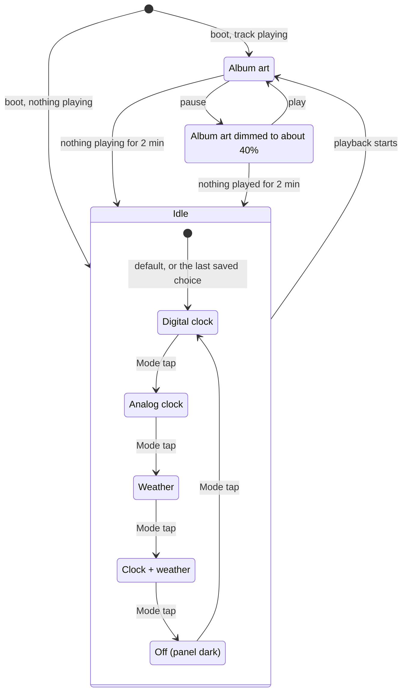
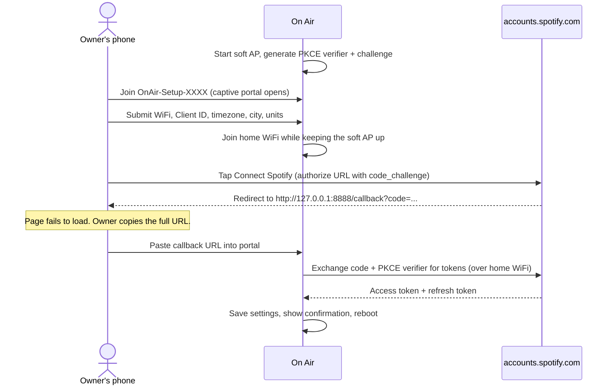
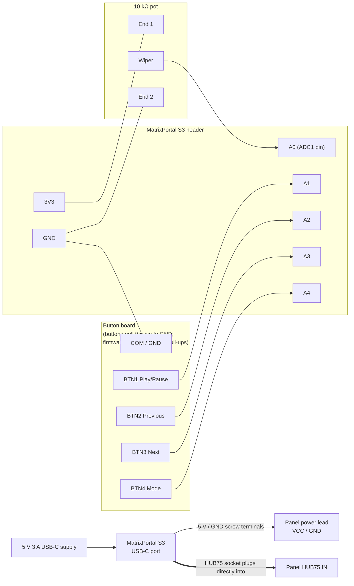
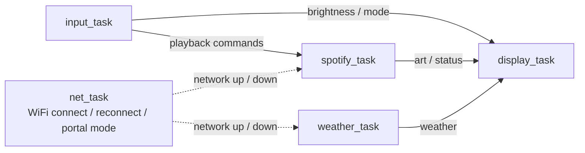
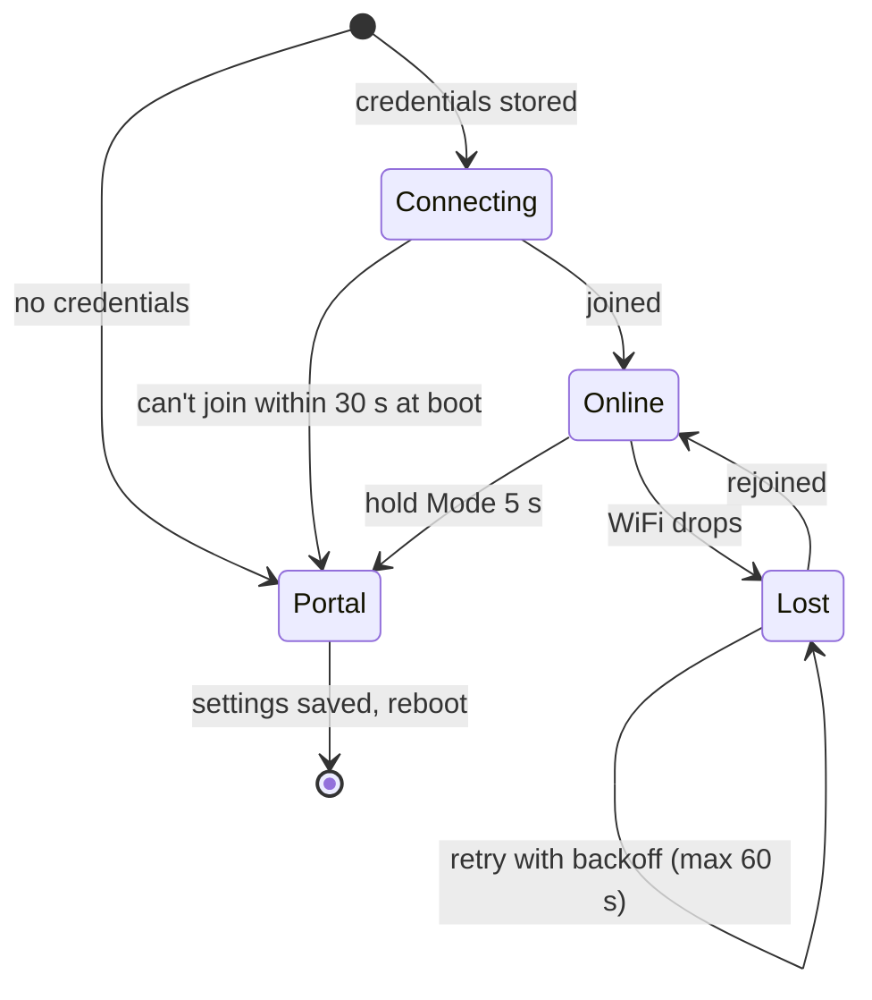

# On Air — Product Requirements

**Status:** Draft v0.1 · **Date:** 2026-11-07 · **Owner:** Mathew Wheatley

## 1. Overview

On Air is a DIY, wall-powered 64×64 RGB LED panel that shows the album art of whatever is playing on the owner's Spotify account. It also has a brightness knob and four playback buttons. Think of it as a home-built [Tuneshine](https://www.tuneshine.rocks/).

### Goals

- Show the current track's album art within a few seconds of the track changing.
- Set up WiFi and Spotify from a phone through a captive portal, with no reflashing.
- Physical controls: brightness knob, play/pause, previous, next, mode. Powered from a single USB-C supply; unplug to turn off.
- When no music is playing, show a clock, the local weather, both, or nothing.
- Firmware written in Rust.
- Built from off-the-shelf modules, with no custom PCB in v1. The enclosure is 3D printed and designed separately.

### Non-goals (v1)

- Battery power. The device always runs from the wall.
- Streaming services other than Spotify.
- Multiple Spotify accounts per device.
- Over-the-air firmware updates (candidate for v2).
- A companion mobile app.

## 2. User stories

1. As the owner, I plug the device in for the first time and the panel tells me how to join its setup network.
2. As the owner, I enter my WiFi and Spotify details on my phone, and the panel starts showing album art.
3. As a listener, when the song changes, the art on the panel changes too.
4. As a listener, I turn the knob to dim or brighten the panel. Turning it fully down gives a minimum brightness that is still visible; the knob never turns the screen off.
5. As a listener, I press buttons on the device to pause, skip or go back.
6. As the owner, when no music is playing, the panel shows a clock (analog or digital), the weather, a clock plus the weather, or nothing, instead of stale art. I pick which with the mode button.
7. As the owner, if my WiFi password changes, I hold a button to reopen the setup portal.

## 3. Functional requirements

### 3.1 Display

| ID | Requirement |
|---|---|
| D-1 | Drive a 64×64 HUB75 panel (1/32 scan, A–E address lines) at a refresh rate of at least 100 Hz with no visible flicker. |
| D-2 | Render a 64×64 RGB888 framebuffer with gamma correction and at least 6 bits per color channel. |
| D-3 | Fetch and decode the 64×64 JPEG that Spotify provides for each album, so no resizing is needed. If no 64 px image exists, downscale the smallest available. |
| D-4 | Crossfade between covers over about 300 ms. |
| D-5 | When playback is paused, dim the art to about 40% of the current brightness. |
| D-6 | Idle screens, cycled with the mode button: **Digital clock**, **Analog clock**, **Weather**, **Clock + weather**, or **Off** (panel dark). Enter the idle screen after nothing has played for a configurable period (default 2 min), and return to album art as soon as playback starts. The selected screen is saved and survives reboots. |
| D-7 | Status screens: setup instructions plus a WiFi-join QR code, "Connecting…", "Spotify sign-in needed", and a "No WiFi" error icon. |
| D-8 | Brightness from the knob scales the whole framebuffer. Firmware caps the total estimated current below the power supply's rating (see §5.2). |
| D-9 | **Clock:** time comes from SNTP in the configured timezone. Digital shows HH:MM (12 h or 24 h, configurable) with the date underneath. Analog shows a round face with hour and minute hands, updated every minute. Before the first SNTP sync, show "--:--" instead of a wrong time. |
| D-10 | **Weather:** a condition icon (sun, cloud, rain, snow, storm, fog), the current temperature, and today's high and low. Units are °C or °F (configurable). |
| D-11 | **Clock + weather:** a digital clock on the top half and a weather icon plus current temperature on the bottom half. |
| D-12 | If weather data is unavailable or older than 2 h, the weather screens show the last known data with a small "stale" marker, or a "No weather" icon if there is none. The clock keeps working. |



### 3.2 Spotify

| ID | Requirement |
|---|---|
| S-1 | Authenticate with OAuth 2.0 Authorization Code + PKCE. The device never stores a client secret. |
| S-2 | Store the refresh token in flash. Spotify may return a new refresh token on each refresh, so save it whenever it does. |
| S-3 | Poll `GET /v1/me/player/currently-playing` every 5 s while playing and every 30 s while idle. Also schedule a poll for the moment the current track should end, using `progress_ms` and `duration_ms`. |
| S-4 | Handle `204 No Content` (nothing playing), `401` (refresh the token and retry once), and `429` (honour the `Retry-After` header). |
| S-5 | Re-download art only when the album image URL changes. Cache the last cover in RAM. |
| S-6 | Buttons call `PUT /me/player/play`, `PUT /me/player/pause`, `POST /me/player/next` and `POST /me/player/previous`. Requires Spotify Premium. Fail gracefully without it. |
| S-7 | Required scopes: `user-read-currently-playing user-read-playback-state user-modify-playback-state`. |

### 3.3 Weather

| ID | Requirement |
|---|---|
| W-1 | Get weather from [Open-Meteo](https://open-meteo.com/) (`GET /v1/forecast` with `current=temperature_2m,weather_code` and `daily=temperature_2m_max,temperature_2m_min`). It is free for personal use and needs no API key. |
| W-2 | Refresh every 15 min while an idle screen that shows weather is selected. Don't fetch weather at all when the selected idle screen doesn't show it. |
| W-3 | Map WMO `weather_code` values to the small set of icons in D-10. |
| W-4 | Location is set in the portal as a city name. The device turns it into latitude and longitude once, using the Open-Meteo geocoding API, and stores the result. |
| W-5 | On errors, retry with exponential backoff (max 15 min) and keep showing the last good data (see D-12). |

### 3.4 Setup portal

| ID | Requirement |
|---|---|
| P-1 | If no WiFi credentials are stored, or the stored network can't be joined after 30 s, start a soft AP named `OnAir-Setup-XXXX` (last 4 hex digits of the MAC). |
| P-2 | Run a DNS responder that answers every query with the device's IP, so phones open the captive-portal page automatically. |
| P-3 | The portal page lists nearby networks, takes the WiFi password, the Spotify Client ID, the timezone, the weather location (city), temperature units and 12/24 h clock, and shows a **Connect Spotify** link. |
| P-4 | **Spotify sign-in (paste-back flow):** the link opens Spotify's authorize page with `redirect_uri=http://127.0.0.1:8888/callback`. After approval the browser lands on a page that fails to load. The user copies that full URL into the portal. The device extracts `code` and exchanges it, together with its stored PKCE verifier, for tokens. To reach Spotify, the device joins the home WiFi while keeping the setup AP running (AP+STA mode). See Q-4. *(This is needed because Spotify only accepts HTTPS or loopback redirect URIs, and the device can't serve HTTPS with a trusted certificate.)* |
| P-5 | On success, save the settings, show a confirmation, and reboot into normal mode. |
| P-6 | Holding **Mode** for 5 s at any time reopens the portal. Holding **Mode + Play** for 10 s erases all settings. |
| P-7 | The panel shows a QR code for joining the setup network, plus the network name as scrolling text. |



### 3.5 Controls

| Control | Input | Behaviour |
|---|---|---|
| Knob (10 kΩ linear) | ADC1 pin | Brightness. Read at 20 Hz, smoothed, with hysteresis and a perceptual curve. Fully down sets a minimum brightness floor (configurable, default about 5%) and never blanks the screen. |
| Button 1 | GPIO, internal pull-up | Play/Pause |
| Button 2 | GPIO | Previous |
| Button 3 | GPIO | Next |
| Button 4 | GPIO | Mode: tap to cycle the idle screen (digital clock → analog clock → weather → clock + weather → off), hold 5 s for the portal |

Buttons are debounced in software (20 ms) and give quick visual feedback on the panel (a small icon for about 500 ms).

Tapping **Mode** while music is playing shows a preview of the next idle screen for about 2 s, then returns to the album art, so the owner can pick a screen without stopping the music.

## 4. Non-functional requirements

| ID | Requirement |
|---|---|
| N-1 | **Latency:** when a track ends on its own, new art shows within 2 s (thanks to the end-of-track poll in S-3). After a skip from another device, new art shows within 7 s. When music starts from idle, art shows within 32 s. |
| N-2 | **Boot:** from power-on to art in under 10 s on a known network. |
| N-3 | **Resilience:** reconnect automatically after WiFi drops, DNS failures and Spotify outages, with exponential backoff (max 60 s). No manual reboot should ever be needed. |
| N-4 | **Watchdog:** a hardware watchdog resets the device if the main loop stalls for more than 30 s. |
| N-5 | **Security:** settings live in a dedicated flash partition. The portal is only reachable on the setup AP, never on the home network. HTTPS to Spotify verifies certificates (see risk R-2). |
| N-6 | **Logging:** structured logs over USB serial using `defmt` or `log`. |
| N-7 | **Testability:** Spotify JSON parsing, the state machine and image handling live in a `no_std` crate with host-side unit tests. |

## 5. Hardware

### 5.1 Bill of materials

What's still to buy, with links, is in [shopping-list.md](shopping-list.md).

| # | Part | Notes | Have? |
|---|---|---|---|
| 1 | Waveshare RGB-Matrix-P2.5-64×64 | HUB75, 1/32 scan, 160×160 mm | ✅ |
| 2 | Adafruit MatrixPortal S3 (#5778) | ESP32-S3, 8 MB flash, 2 MB PSRAM, HUB75 socket, level shifters, NeoPixel, 2 onboard buttons | Buy |
| 3 | 5 V 3 A USB-C power supply (15 W) | Must supply 3 A at 5 V. Plain USB-C, no PD negotiation needed. | Buy |
| 4 | 10 kΩ linear potentiometer + knob | Brightness | ✅ |
| 5 | 4-button momentary board | Check whether it has its own pull-ups or an LED, and the voltage it expects | ✅ |
| 6 | 26 AWG wire (signals), Dupont/JST-PH leads | | COTS |
| 7 | Enclosure plus LED diffuser | 3D printed, including the diffuser (for example a printed grid or a thin translucent layer). Designed separately, outside this doc. Leave an opening for the MatrixPortal's USB-C port. | Print |

### 5.2 Power budget

| Load | Typical | Worst case |
|---|---|---|
| Panel showing album art, mid brightness | 1.0–1.5 A | — |
| Panel at full white, full brightness | — | ~4 A *(confirm with the Waveshare datasheet or a bench measurement)* |
| MatrixPortal S3 with WiFi | 0.1–0.25 A | 0.35 A |
| **Total at 5 V, uncapped** | **~1.5 A** | **~4.3 A** |
| **Total at 5 V, with firmware cap** | **~1.5 A** | **≤ 2.5 A** |

Firmware enforces a current cap (D-8). It estimates draw from the sum of pixel values multiplied by brightness and scales the brightness down to stay under about 2.5 A, which leaves headroom on a 3 A USB-C supply. Typical album art never reaches the cap; only very bright, mostly white images get dimmed.

If the cap ever dims images too much (or a second panel is added), power the panel from a separate 5 V 4 A+ supply and keep the MatrixPortal on USB-C, as Adafruit does in its larger builds.

### 5.3 Wiring



Notes:

- **Power path:** USB-C is the only power input. The MatrixPortal passes 5 V from USB-C out through its screw terminals to the panel, which is how Adafruit intends the board to be powered. Never feed 5 V *into* the screw terminals.
- **No fuse or diode:** a UL-listed USB-C supply has its own short-circuit and overload protection, and with only one power input there is nothing for a diode to isolate.
- **No power switch:** unplug the USB-C cable to turn the device off.
- **No extra parts:** no bulk capacitor, matching Adafruit's builds. If the board ever resets or the panel flickers on bright screens, a 1000 µF (10 V or more) capacitor across the panel's VCC/GND is the first fix to try.
- **Address E jumper:** 64-row panels need the HUB75 E line. Set the MatrixPortal's address-E jumper as described in Adafruit's guide.
- **Pin mapping:** map the GPIO numbers for A0–A4 from the Adafruit pinout before writing firmware. The pot must be on an ADC1 pin (GPIO 1–10 on the S3), because ADC2 conflicts with WiFi.
- **Button board:** if it has a VCC pin, power it from 3V3, never 5 V.

## 6. Firmware

### 6.1 Stack

| Concern | Choice |
|---|---|
| Toolchain | Rust Xtensa toolchain installed with `espup`. Build with `cargo` and flash with `espflash`. *(Not PlatformIO, which doesn't support Rust.)* |
| HAL / runtime | `esp-hal` (`no_std`) + `embassy-executor`, `embassy-time`, `embassy-sync` |
| Display | `esp-hub75`, which uses the S3's LCD_CAM peripheral with DMA. `embedded-graphics` for drawing, `u8g2-fonts` for text, and `tinyqoi` or `tinybmp` for icons stored as image files. |
| WiFi / net | `esp-radio` (formerly `esp-wifi`) + `embassy-net` |
| HTTP(S) | `reqwless` + TLS (see R-2) |
| JSON | `serde` + `serde_json` with `alloc` (PSRAM heap) |
| JPEG | `zune-jpeg` (`no_std` + `alloc`) |
| QR | `qrcodegen-no-heap` |
| Setup portal | `edge-captive` (captive-portal DNS) + `picoserve` (HTTP server) |
| Buttons | `debouncr` |
| Time | `sntpc` for SNTP; `jiff` with its bundled IANA timezone database for local time |
| Weather | Open-Meteo over HTTPS with `reqwless`; same JSON stack as Spotify |
| Settings storage | `sequential-storage` on a dedicated flash partition |
| Heap | `esp-alloc`, backed by PSRAM |

### 6.2 Tasks



- **display_task:** owns the HUB75 driver and framebuffers, and handles crossfades, status screens, idle screens (clocks and weather) and the current cap.
- **spotify_task:** token refresh, polling, art download and decode, and playback commands.
- **input_task:** knob sampling and button debouncing. Sends brightness, mode and command events.
- **weather_task:** fetches Open-Meteo data on its schedule (W-2) and publishes the latest reading.
- **net_task:** runs the WiFi state machine (`Connecting → Online → Lost → Portal`). Starts the AP, DNS server and HTTP server in portal mode.
- Tasks talk over `embassy_sync` channels and signals. Shared state is a small `Watch` holding the app state.

**net_task states:**



### 6.3 Stored settings

| Key | Value |
|---|---|
| `wifi.ssid` / `wifi.pass` | WiFi credentials |
| `spotify.client_id` | From the owner's Spotify developer app |
| `spotify.refresh_token` | Rewritten whenever Spotify rotates it |
| `ui.idle_mode` | `clock_digital` / `clock_analog` / `weather` / `clock_weather` / `off` |
| `ui.timezone` | IANA timezone name for the clock, e.g. `America/Los_Angeles` |
| `ui.clock_24h` | `true` / `false` |
| `weather.city` | City name as typed in the portal |
| `weather.lat` / `weather.lon` | Coordinates from geocoding |
| `weather.units` | `c` / `f` |

## 7. Repository layout

```
on-air/
├── README.md
├── Cargo.toml               workspace for the host-buildable crates
├── docs/
│   ├── requirements.md      ← this document
│   ├── shopping-list.md     parts to buy, with links
│   ├── implementation-plan.md  software build plan
│   └── hardware.md          (build guide, photos; later)
├── crates/
│   ├── core/                crate `on-air-core`: no_std logic: Spotify and weather models, state machine, image utils (host-tested)
│   └── ui/                  crate `on-air-ui`: no_std screens drawn with embedded-graphics (shared by simulator and firmware)
├── firmware/                esp32s3 binary crate (esp-hal + embassy), outside the workspace
│   ├── .cargo/config.toml
│   ├── rust-toolchain.toml  channel = "esp"
│   └── src/
└── tools/
    └── sim/                 desktop panel simulator
```

## 8. Milestones

The software side of each milestone is broken down in [implementation-plan.md](implementation-plan.md).

| # | Milestone | Done when |
|---|---|---|
| M0 | **Panel spike** | `esp-hub75` shows a solid color and then a test pattern on the panel, with the correct E line and no flicker. |
| M1 | **Inputs** | The knob changes brightness and the 4 buttons log events. |
| M2 | **Network spike** | Joins WiFi from hard-coded credentials and completes an HTTPS GET to `api.spotify.com` with certificate checks. |
| M3 | **Spotify happy path** | A hard-coded refresh token gets the current track, then downloads, decodes and shows the cover. |
| M4 | **Portal** | Soft AP, DNS capture, form, PKCE paste-back flow and saved settings. |
| M5 | **Idle screens** | Digital and analog clocks, weather fetch and icons, clock + weather layout, mode button cycling. |
| M6 | **Polish** | Crossfade, status screens, backoff, watchdog, playback buttons. |
| M7 | **Enclosure** | Electronics fit the 3D-printed case (designed separately), with the knob mounted, the diffuser fitted and the MatrixPortal's USB-C port reachable from outside. |

## 9. Risks and open questions

| ID | Item | Mitigation |
|---|---|---|
| R-1 | `esp-hub75` may not support this panel's scan pattern, or may need driver-chip setup (some panels use FM6126A-type chips that need an init sequence). | M0 spike comes first. Fallback is a thin Rust wrapper around the C `ESP32-HUB75-MatrixPanel-DMA` library via `esp-idf`, which would mean switching to the `std` stack. |
| R-2 | TLS: `embedded-tls` supports TLS 1.3 only and has limited certificate verification; `esp-mbedtls` is heavier but more complete. | Decide in M2. The device needs `accounts.spotify.com`, `api.spotify.com`, `i.scdn.co`, `api.open-meteo.com` and `geocoding-api.open-meteo.com`. Pin the root CAs. |
| R-3 | Rust captive-portal crates are young. | Use `edge-captive` for the DNS side and `picoserve` for HTTP; only the form page and sign-in flow are written in-repo. |
| R-4 | Spotify developer-mode limits: only allowlisted users, possible Premium requirement for the app owner, and future API policy changes. | Personal use only. Document the app setup in the README. |
| R-5 | Memory: TLS buffers, JSON and JPEG decoding together. | Put the heap in PSRAM, read large responses as streams, and only download the 64 px image. |
| R-6 | A readable analog clock and weather layout at 64×64 px. | Mock the screens in the host panel simulator (`tools/`) before M5. |
| Q-1 | Can the MatrixPortal's USB-C input and screw terminals carry about 2.5 A to the panel continuously? Adafruit doesn't publish a rating. | Check the schematic in Adafruit's PCB repo, and check that the board stays cool at the cap during the M0 bench test. Lower the cap if needed. |
| Q-2 | Pinout and pull-ups on the button board. | Check the board before wiring. |
| Q-3 | Measured maximum current draw of the panel. | Bench-measure in M0 and tune the firmware cap (default 2.5 A). |
| Q-4 | During sign-in the phone is on the setup network, which has no internet, so it may not reach Spotify's login page. iOS and Android captive-portal windows may also make copying the callback URL hard. | Test in M4. Options: let the phone fall back to mobile data, have the device bridge traffic while it is on home WiFi, or tell the owner to open the portal in the full browser. |

## 10. Spotify app setup (owner, one time)

1. Create an app at <https://developer.spotify.com/dashboard>.
2. Add the redirect URI `http://127.0.0.1:8888/callback`.
3. Select **Web API**.
4. Copy the **Client ID** into the On Air setup portal.
